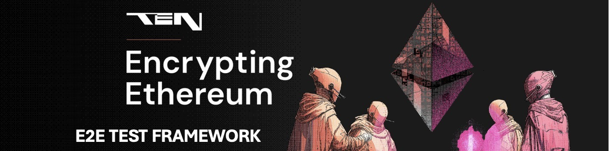

<h1 align="center">
  <picture>
    
  </picture>
</h1>

[](https://www.gnu.org/licenses/agpl-3.0)

[](https://github.com/ten-protocol/ten-test/actions/workflows/execute_local_tests.yml)
[](https://github.com/ten-protocol/ten-test/actions/workflows/execute_merge_tests.yml)


Project repo for running end to end system tests against a variety of networks, with [Ten](https://obscu.ro/) being 
the primary network under test. Other networks supported include [Ganache](https://trufflesuite.com/ganache/), 
[Arbitrum](https://arbitrum.io/) and [Sepolia](https://sepolia.dev/). The repo uses the [pysys](https://pysys-test.github.io/pysys-test/) 
test framework to manage all tests and their execution. All tests are fully system level using [web3.py](https://web3py.readthedocs.io/en/stable/) 
to interact with the networks which are managed outside the scope of the tests (with the exception of ganache which can 
be started locally). Note the project is currently under active development and further information on running the tests 
will be added to this readme over time. 

Repository Structure
--------------------
The top level structure of the project is as below;

```
├── README.md            # Readme 
├── .github              # Github configuration including workflows
├── .default.properties  # Default properties file detailing connection and keys required for running 
├── pysysproject.xml     # The pysys project file detailing configuration options
├── get_artifacts.sh     # Build script to build artifacts from go-ten required for running Ten protocol tests
├── artifacts            # Directory to store artifacts for running Ten tests
├── src                  # The source root for all test code
│    ├── grafana         # Export of the grafana dashboards
│    ├── javascript      # A library of javascript client tooling
│    ├── python          # The python source root for pysys extensions
│    └── solidity        # A library of smart contracts 
├── tests                # The test root for all tests 
│    ├── admin           # Used for administering the Ten testnet 
│    ├── dapps           # Used for any dapps managed by TEN 
│    └── network         # Used for testing the TEN network
│         ├── generic    # Network agnostic tests 
│         └── ten        # TEN specific tests 
└── utils                # The project utils root for utilities used by the tests
     ├── docker          # Docker build and run files
     ├── github          # Azure VM github self hosted running build files
     ├── release         # Utilitiy scripts for making a new release of go-ten
     └── support         # Contains the support rota
```

The [.default.properties](./.default.properties) file contains properties for running the tests that are common to any 
user. User specific properties should be added into a `~/.tentest/user.properties` file.  Properties will first be 
looked for in the `~/.tentest/user.properties` should it exist, and if not will fall back to the default properties. 


Setup and run locally using docker
----------------------------------
Should you wish to run the tests locally on your host machine against a local testnet, the easiest approach is to use
the docker image for the e2e tests. Prior to running, a local testnet should be built and run as described in the section 
[Building and running a local testnet](https://github.com/ten-protocol/go-ten?tab=readme-ov-file#building-and-running-a-local-testnet)
of the go-ten repository README.md file. Once the local testnet is running, the e2e docker image can be pulled down from 
the Azure container registry and run from the root of the `ten-test` repository using the below; 

```bash
./utils/docker/run_image.sh --version=<version>
```

where version should be `latest` if the latest build from main is required, or otherwise the released version of 
`go-ten` and `ten-test` e.g. 0.19 , 0.18 etc. Note that this represents the head of the relevant releases 
branch and therefore will be the latest patch release of that major.minor version. 


Setup and run locally on host machine
-------------------------------------
As stated earlier, running the tests requires the `ten-test` repository to be cloned in the same parent directory 
as `go-ten`, and the dependent artifacts to be built (these are the wallet extension, and the ABIs for the bridge
contracts). To build the artifacts run `./get_artifacts.sh` in the root of the `ten-test` checkout. To install all 
dependencies for running the tests use the following on OSX or Linux accordingly;

### OSX (Monterey 12.4)
```bash
/bin/bash -c "$(curl -fsSL https://raw.githubusercontent.com/Homebrew/install/HEAD/install.sh)"
brew update
brew upgrade

brew remove node --force
brew install node@20   
brew link --overwrite node@20

brew tap ethereum/ethereum
brew install ethereum
brew install solidity
brew install python
brew install gnuplot

npm install solc@0.8.15 --global
npm install console-stamp@3.1.2 --global
npm install ganache@7.9.1 --global
npm install ganache-cli@6.12.2 --global
npm install web3@1.9.0 --global
npm install ethers@5.7.2 --global
npm install ethers6@npm:ethers@6.13.1 --global
npm install commander@11.1.0 --global
npm install @openzeppelin/merkle-tree@1.0.6 --global
npm install @ethereumjs/rlp@5.0.2 --global

pip3 install web3==6.13.0 
pip3 install pysys==1.6.1
pip3 install solc-select==1.0.4 
pip3 install py-solc-x==2.0.2
pip3 install numpy==1.26.4
pip3 install mysql-connector-python==9.0.0
pip3 install rlp==3.0.0
pip3 install twilio==9.6.0
pip3 install pytz==2025.2

solc-select install 0.8.15
solc-select use 0.8.15
```

### Linux (Ubuntu 20.04)
```bash
apt update
DEBIAN_FRONTEND=noninteractive apt-get install -y tzdata
apt-get install -y software-properties-common
add-apt-repository ppa:ethereum/ethereum
apt update
apt install -y curl
apt install -y solc
apt install -y gnuplot
apt install -y ethereum

curl -sL https://deb.nodesource.com/setup_20.x | bash -
apt-get install -y nodejs
npm install console-stamp --global
npm install ganache --global
npm install ganache-cli --global
npm install web3@1.9.0 --global
npm install ethers@5.7.2 --global
npm install ethers6@npm:ethers@6.13.1 --global
npm install commander@11.1.0 --global
npm install @openzeppelin/merkle-tree@1.0.6 --global

apt install -y python3-pip
python3 -m pip install eth-account==0.10.0
python3 -m pip install web3==6.13.0
python3 -m pip install pysys==1.6.1
python3 -m pip install solc-select
python3 -m pip install py-solc-x
python3 -m pip install numpy==1.24.4
python3 -m pip install mysql-connector-python==9.0.0
python3 -m pip install rlp==3.0.0
python3 -m pip install twilio==9.6.0
python3 -m pip install pytz==2025.2
```

Once installed it should be possible to run all tests from the pysys.py cli as described in the following sections. Note
that depending on differences in your installation, and should you want to add in your own accounts on Sepolia or Arbitrum, 
you may need to override the `.default.properties` file by creating a user specific properties file in
`~/.tentest/user.properties`. Common overrides will include the path to various binaries used when running the tests, 
and account details. An example of an override properties file is as given below where binary locations and the project ID 
for Sepolia and Arbitrum are set as overrides, along with real accounts as set up within metamask;

```
[binaries.darwin]
solc = /opt/homebrew/bin/solc 
ganache = /opt/homebrew/bin/ganache-cli
node = /opt/homebrew/bin/node
node_path = /opt/homebrew/lib/node_modules

[env.all]
Account1PK=<private key of account 1 available e.g. via metamask>
Account2PK=<private key of account 2>
Account3PK=<private key of account 3>
Account4PK=<private key of account 4>

[env.sepolia]
ProjectID = <id>

[env.arbitrum.sepolia]
APIKey = <api key>
```

Print and run tests
--------------------
Each test is a separate directory within `ten-test/tests/network` where the directory name denotes the testcase id. Each 
test will contain a `run.py` file (the execution and validation steps) and a `pysystest.xml` file (metadata about the 
test such as its title, purpose, supported modes it can be run in). Note that the tests can be run against a variety 
of networks using the `-m mode` option. The E2E tests have specifically been designed such that any generic tests 
can be run against Ten, Ganache, Arbitrum or Sepolia. To print out information on the tests, or to run them 
against a particular network, change directory to `ten-test/tests/network` and run as below;

```bash
# print out test titles
pysys.py print 

# print out full test details
pysys.py print -f

# run the tests against Ten sepolia-testnet
pysys.py run -m ten.sepolia

# run the tests against Ten uat-testnet
pysys.py run  -m ten.uat

# run the tests against Ten dev-testnet
pysys.py run -m ten.dev 

# run the tests against Ten local testnet
pysys.py run -m ten.local

# run the tests against Ten sim testnet
pysys.py run -m ten.sim

# run the tests against a local ganache network 
pysys.py run -m ganache

# run the tests against the Arbitrum network 
pysys.py run -m arbitrum.sepolia

# run the tests against the Sepolia network 
pysys.py run -m sepolia
```

Note that should you wish to run against a Ten local testnet, you will need to build and run the local testnet 
yourself using the approach as described in the [go-ten readme](https://github.com/ten-protocol/go-ten#building-and-running-a-local-testnet). 
Both the local testnet and the faucet will need to be started. To run against ganache the test framework will start the 
local ganache network on your behalf, and tear it down when test execution is complete. To run the same tests against 
Sepolia or Arbitrum, the `~/.tentest/user.properties` should be created as described earlier. 

If you wish to run against a Ten simulated testnet, you will need to run the simulation from within the go-land IDE, and 
additionally start the faucet manually. To run the network, in the IDE run the method `TestRunLocalNetwork` within the 
file `integration/networktest/tests/helpful/spin_up_local_network_test.go`. In order for the network to come up, you 
need to set the IDE flag in the Run Configurations to true, or remove the line `networktest.TestOnlyRunsInIDE(t)` from 
within the method. To run the faucet, in `go-ten` directory execute the below;

```
go run ./tools/faucet/cmd --nodePort 25801 -nodeHost 127.0.0.1  --pk 0x8dfb8083da6275ae3e4f41e3e8a8c19d028d32c9247e24530933782f2a05035b --jwtSecret This_is_the_secret --serverPort 99
```


Running a specific test or range of tests
-----------------------------------------
The [pysys](https://pysys-test.github.io/pysys-test/) launch cli provides a rich interface to allow you to run a 
specific test, ranges of tests, or groups of tests, as well as running them in different modes, with different 
verbosity logging, and in cycles. See the cli documentation for more detail using `pysys.py run -h`. When running tests 
pysys will search the directory tree for all tests available from the current working directory downwards, and then 
filter based on the user request e.g. 


```bash
# run a specific test
pysys.py run -m ten.sepolia gen_cor_001

# run a range of tests (using python list slicing syntax)
pysys.py run -m ten.sepolia gen_cor_001:gen_cor_004
pysys.py run -m ten.sepolia gen_cor_003:

# run a test multiple times
pysys.py run -m ten.sepolia -c 5 gen_cor_003

# run a test with full verbosity logging
pysys.py run -m ten.sepolia -v DEBUG gen_cor_003
```


Current network tests
---------------------

<details>
``` 
gen_cor_001  | RPC API: check chain_id 
gen_cor_002  | RPC API: check get_block_number 
gen_cor_003  | RPC API: check get_balance 
gen_cor_004  | RPC API: check get_block_by_number
gen_cor_005  | RPC API: check get_block_by_hash
gen_cor_006  | RPC API: check gas_price
gen_cor_007  | RPC API: check get_code
gen_cor_008  | RPC API: check estimate_gas
gen_cor_009  | RPC API: check get_transaction_count
gen_cor_010  | RPC API: check get_transaction_by_hash
gen_cor_040  | Guesser: no state changing, deploy contract and guess the value
gen_cor_041  | Guesser: state changing, deploy contract and guess the value
gen_cor_045  | Game: play a sample guessing game, deploy and transact over web-sockets
gen_cor_050  | Error: revert, require and assert on pure function call
gen_cor_051  | Error: require on transaction
gen_cor_052  | Error: revert on transaction
gen_cor_053  | Error: revert on non-view function via ethers and web3js
gen_cor_054  | Error: group txs in a batch with one causing a revert
gen_cor_055  | Error: delete a storage mapping and check no errors occur
gen_cor_056  | Error: deploy a payable contract that reverts in the constructor
gen_cor_058  | Payable: send native funds to a contract address
gen_cor_059  | Payable: send funds to a contract address from another contract
gen_cor_060  | ERC20: transfer, approve and transferFrom from using three accounts
gen_cor_062  | ERC20: repeated transfer with concurrent python client polling balance
gen_cor_063  | ERC20: repeated transfer with concurrent javascript client polling balance
gen_cor_070  | Events: transact and check transaction receipt event log
gen_cor_071  | Events: filter and get new entries since deployment
gen_cor_072  | Events: web3py client polling using filter.get_new_entries
gen_cor_073  | Events: web3js client contract.getPastEvents, fromBlock toBlock
gen_cor_074  | Events: web3js client contract.getPastEvents, filter and topics
gen_cor_077  | Events: web3js client using contract.events.Event
gen_cor_078  | Events: web3js client using contract.events.allEvents
gen_cor_079  | Events: web3js client using eth.subscribe on logs (event Keccak256 only)
gen_cor_080  | Events: web3js client using eth.subscribe on logs for event and fromBlock
gen_cor_081  | Events: web3js client using eth.subscribe on logs for event and contract address
gen_cor_082  | Events: web3js client using eth.subscribe on logs for event and range of values
gen_cor_083  | Events: web3js client using eth.subscribe and unsubscribe
gen_cor_084  | Events: ethers client contract.queryFilter, fromBlock toBlock
gen_cor_085  | Events: ethers client using contract.on, with event name
gen_cor_086  | Events: ethers client using contract.on, with two concurrent filters
gen_cor_087  | Events: ethers client using provider.on, with single filter
gen_cor_088  | Events: web3js client using eth.subscribe on logs for event with account address and number
gen_cor_089  | Events: web3js client using eth.subscribe on logs for event with only an account address
gen_cor_090  | Events: web3js getPastEvents from EventEmitter indexed on a uint
gen_cor_091  | Events: web3js compare subscriber and poller using getPastEvents
gen_cor_094  | Events: subscribe to an event that contains a struct
gen_cor_100  | Persistent: running against a pre-deployed storage contract
gen_cor_101  | Persistent: running against a pre-deployed key storage contract
gen_cor_102  | Transact: ethers client send a single transaction to a contract function
gen_cor_103  | Transact: ethers client send a single transaction to transfer funds
gen_cor_104  | Transact: web3js client send a single transaction to a contract function
gen_cor_105  | Transact: web3js client send a single transaction to transfer funds
gen_cor_106  | Callback: ethers client using provider once "block" (newHeads)
gen_cor_107  | Callback: ethers client using provider on pending (newPendingTransactions) and then once on txHash
gen_cor_108  | Callback: ethers client using provider on "block" and then off (newHeads)
gen_cor_109  | Callback: web3js client using eth.subscribe (newHeads)
gen_cor_110  | Transact: ethers throws CALL_EXCEPTION on using wrong contract address
gen_cor_111  | Access List - one contracts calls another with and without using access lists
gen_cor_112  | Transact: ethers6 client send a single transaction to a contract function
gen_cor_113  | Transact: ethers client send a single transaction and parse the events
gen_cor_120  | Hardhat: deploy a single contract
gen_cor_121  | Hardhat: deploy a contract using a library
gen_cor_122  | Hardhat: deploy and upgrade a contract through a transparent proxy
gen_cor_123  | Hardhat: deploy and upgrade a contract with state through a transparent proxy
gen_cor_124  | Hardhat: deploy then transfer ownership and upgrade through transparent proxy
gen_cor_125  | Hardhat: deploy an upgradable contract through a UUPS proxy
gen_cor_126  | Hardhat: deploy an upgradable contract through a beacon proxy
gen_cor_132  | Gas: Perform eth_calls using a contract with balance, and with no balance
gen_cor_133  | Gas: Submit transfer of funds and check expected balance changes
gen_cor_134  | Gas: Large call data
gen_cor_135  | Gas: call estimate_gas on so called expensive solidity method calls
gen_cor_136  | Mempool: submit with gas price leading to insufficient funds
gen_cor_137  | Mempool: submit at or below the intrinsic gas limit
gen_cor_138  | Mempool: submit a tx with a nonce too low
gen_cor_139  | Mempool: send value with funds only covering the gas cost
ten_cor_001  | Zen: check the zen balance increases with each transaction
ten_cor_002  | Event relevancy: 4 accounts own gateway, 4 accounts subscribe, 1 relevant event, 1 received
ten_cor_003  | Event relevancy: 4 accounts single gateway and token, 1 account subscribes, 4 unique relevant events
ten_cor_004  | Event relevancy: 4 accounts own gateway, 4 accounts subscribe, 1 relevant event two addresses, 2 received
ten_cor_005  | Event relevancy: 4 accounts own gateway, 4 accounts subscribe, 1 life-cycle event, 4 received
ten_cor_006  | Event relevancy: 4 accounts single gateway single token, 1 account subscribes, 1 lifecycle events
ten_cor_007  | Rollups: check the L1 rollup is persisted for a successful transaction
ten_cor_010  | Tenscan RPC: scan_getPublicTransactionData get public transaction data
ten_cor_011  | Tenscan RPC: scan_getPublicTransactionData read last 2 pages
ten_cor_012  | Tenscan RPC: scan_getBatchByTx check transaction batch header is correct
ten_cor_013  | Tenscan RPC: scan_getTotalContractCount and scan_getTotalTransactionsQuery
ten_cor_014  | Tenscan RPC: eth_getStorageAt for personal transactions (contract calls, transfers)
ten_cor_015  | Tenscan RPC: eth_getStorageAt for personal transactions (ccount with no tx history)
ten_cor_016  | Error: response when calling getStorageAt
ten_cor_017  | Tx receipt: check the contents of a transaction receipt against ten
ten_cor_018  | Error: Transact using an invalid chain id
ten_cor_019  | Account going through separate connection can't get receipt or logs
ten_cor_020  | Bridge: create and whitelist token, send tokens across the bridge L1 to L2
ten_cor_021  | Bridge: create and whitelist token, send and withdraw tokens across the bridge
ten_cor_022  | Bridge: send native funds across the bridge using bridge sendNative
ten_cor_024  | Bridge: withdraw native funds across the bridge using sendNative and relayMessageWithProof
ten_cor_025  | Bridge: withdraw native funds with multiple transactions included in the cross chain tree
ten_cor_026  | Bridge: ethers withdraw native funds across the bridge using sendNative and relayMessageWithProof
ten_cor_027  | Bridge: send native funds across the bridges, subscribe for events
ten_cor_028  | Bridge: send and withdraw native funds and tokens in single xchain message
ten_cor_030  | Gateway: single gateway with two token connections and two accounts registered (subscribe contract)
ten_cor_031  | Gateway: two registered users with a single subscription (subscribe all logs)
ten_cor_032  | Nested: store and retrieve from a nested structure
ten_cor_033  | Gateway: use getMessage for authentication message format
ten_cor_034  | Config: check ten contracts have code
ten_cor_035  | Gateway: get network config and check privacy headers
ten_cor_036  | Gateway: check per IP rate limiting on join
ten_cor_037  | Gateway: check global rate limiting on join
ten_cor_040  | Gas: check payment is taken on a transaction and goes to the holding account
ten_cor_041  | Gas: fire increasingly costly transactions attempting into a single batch
ten_cor_042  | Gas: cost of addition
ten_cor_043  | Gas: cost of multiplication
ten_cor_044  | Gas: cost of getting account balance (in contract)
ten_cor_045  | Gas: gasUsed times gasPrice should equate to balance change
ten_cor_046  | Create2: deploy a contract via create2 and check predicted address is correct
ten_cor_047  | WETH: check contracts are available
ten_cor_048  | WETH: bridge some WETH from the L1 to the L2 and back again
ten_cor_050  | Hardhat: deploy a single contract using the ten plugin
ten_cor_051  | Hardhat: deploy two contracts using the hardhat deploy and ten plugins using typescript
ten_cor_060  | Visibility Config: subscribe, ContractCfg.TRANSPARENT, check storageAt
ten_cor_061  | Visibility Config: subscribe, ContractCfg.TRANSPARENT, check events
ten_cor_062  | Visibility Config: subscribe, ContractCfg.PRIVATE, Field.EVERYONE on one event
ten_cor_063  | Visibility Config: subscribe, ContractCfg.PRIVATE, Field.TOPIC1 on one event
ten_cor_064  | Visibility Config: subscribe, ContractCfg.PRIVATE, Field.TOPIC2 on one event
ten_cor_065  | Visibility Config: subscribe, ContractCfg.PRIVATE, Field.SENDER on one event
ten_cor_066  | Visibility Config: subscribe, ContractCfg.PRIVATE, Field.EVERYONE on two events
ten_cor_067  | Visibility Config: subscribe, ContractCfg.PRIVATE, no topics relevant to anyone
ten_cor_070  | Visibility Config: get logs, ContractCfg.TRANSPARENT, check events
ten_cor_071  | Visibility Config: get logs, ContractCfg.PRIVATE, Field.EVERYONE on one event
ten_cor_072  | Visibility Config: get logs, ContractCfg.PRIVATE, Field.TOPIC1 on one event
ten_cor_073  | Visibility Config: get logs, ContractCfg.PRIVATE, Field.TOPIC2 on one event
ten_cor_074  | Visibility Config: get logs, ContractCfg.PRIVATE, Field.TOPIC1 TOPIC2 SENDER on one event
ten_cor_075  | Visibility Config: get logs, ContractCfg.PRIVATE, Field.EVERYONE on two events
ten_cor_080  | Visibility Config: tx receipt, ContractCfg.TRANSPARENT, check events
ten_cor_081  | Visibility Config: tx receipt, ContractCfg.PRIVATE, Field.EVERYONE on one event
ten_cor_082  | Visibility Config: tx receipt, ContractCfg.PRIVATE, Field.TOPIC1 on one event
ten_cor_083  | Visibility Config: tx receipt, ContractCfg.PRIVATE, Field.TOPIC2 on one event
ten_cor_084  | Visibility Config: tx receipt, ContractCfg.PRIVATE, Field.TOPIC1 TOPIC2 SENDER on one event
ten_cor_085  | Visibility Config: tx receipt, ContractCfg.PRIVATE, Field.EVERYONE on two events
ten_cor_090  | Visibility Config: contract calls another, both emit an event with address, only one an EOA
ten_cor_091  | Visibility Config: contract calls another, both emit an event with address, both contain same EOA
ten_cor_092  | Visibility Config: contract calls another, both emit an event with address, both contain different EOA
ten_cor_093  | Visibility Config: contract calls another, ContractCfg.TRANSPARENT on called, check events
ten_cor_094  | Visibility Config: array, struct and mapping events for ContractCfg.TRANSPARENT
ten_cor_095  | Visibility Config: request debug_logVisibility, single lifecycle event, default contract
ten_cor_096  | Visibility Config: request debug_logVisibility, single non-lifecycle event, default contract
ten_cor_097  | Visibility Config: visibility with an event sig with zero hash
ten_cor_098  | Visibility Config: visibility with a large gas cost should burn all the supplied gas
ten_cor_099  | Visibility Config: deploy a contract using a visibility config via a proxy
ten_cor_100  | Visibility Config: deploy and upgrade contract using a visibility config via a proxy (logic only)
ten_cor_101  | Visibility Config: deploy and upgrade contract from no visibility config to transparent
ten_cor_102  | Session keys: transact through a session key, get past event logs
ten_cor_103  | Session keys: transact through a session key, subscribe event logs
ten_cor_104  | Session keys: transact through a session key, get events logs from receipt
ten_cor_105  | Session keys: transact through a session key through different connection
ten_cor_106  | Session keys: transact through a session key sending an unsigned transaction via getStorageAt
ten_cor_107  | Session keys: delete a session key after transacting
ten_cor_110  | Callbacks: storage privacy callback implementation with and without events
ten_cor_111  | Callbacks: privacy callback with life-cycle event, contract.getPastEvents to get new entries
ten_cor_112  | Callbacks: privacy callback with life-cycle event, using contract.events.Event
ten_cor_113  | Callbacks: privacy callback with life-cycle event, using eth.subscribe on logs (event Keccak256)
ten_cor_114  | Callbacks: privacy callback where the callback triggers a require
ten_cor_115  | Callbacks: privacy callback where the callback triggers a revert
ten_cor_116  | Callbacks: privacy callback having a receive with a revert
ten_cor_117  | Callbacks: privacy callback with large call data
ten_cor_118  | Callbacks: privacy callback with non life-cycle event, using eth.subscribe on logs
ten_cor_119  | Callbacks: privacy callback on the storage contract with a refund
ten_cor_130  | System Calls: get random number a set number of times and validate entropy
ten_cor_131  | System Calls: get random number within and outside of block time
ten_cor_132  | System Calls: transact and emit an event with a random number
ten_cor_133  | System Calls: transact and emit an event with the tx timestamp
ten_cor_140  | Node - start a new node to join the network and transact through it
ten_cor_150  | Tenscan RPC: eth_getStorageAt for personal transactions (transparent contract)
ten_cor_151  | Tenscan RPC: eth_getStorageAt for personal transactions (event is public)
ten_cor_152  | Tenscan RPC: scan_getBlockListing get L1 block data
ten_cor_153  | Tenscan RPC: scan_getBatchListing get L2 block data
ten_cor_154  | Tenscan RPC: scan_getBatch get L2 batch data
ten_cor_155  | Tenscan RPC: scan_getLatestBatch get latest L2 batch data
ten_cor_156  | Tenscan RPC: scan_getBatchByHeight get L2 batch data by number
ten_cor_157  | Tenscan RPC: scan_getBatchBySeq get L2 batch data by sequencer number
ten_cor_158  | Tenscan RPC: scan_getTransaction get L2 transaction data
ten_cor_159  | Tenscan RPC: scan_getRollupListing get L2 rollup data
ten_cor_160  | Tenscan RPC: scan_getRollupByHash get rollup by hash
ten_cor_161  | Tenscan RPC: scan_getRollupBatches get all rollup batches by pagination
ten_cor_162  | Tenscan RPC: scan_getRollupBySeqNo get all rollup batches by sequence
ten_cor_163  | Tenscan RPC: scan_getBatchTransactions get the transactions for a batch
ten_cor_164  | Tenscan RPC: scan_search by hash and height
ten_per_001  | TPS: funds transfer, single client in process (1 sending, 1 receiving account)
ten_per_002  | TPS: funds transfer, two external concurrent clients (1 sending, 8 receiving accounts each)
ten_per_003  | TPS: funds transfer, two external concurrent clients (20 sending, 8 receiving accounts each)
ten_per_004  | TPS: funds transfer, four external concurrent clients (1 sending, 8 receiving accounts each)
ten_per_005  | TPS: key storage, configurable number of external concurrent clients
ten_per_006  | TPS: rates for funds transfer, using increasing clients within the test run
ten_per_007  | TPS: rates for funds transfer, increasing clients, includes xchain messages
ten_per_008  | TPS: transaction timing with attached subscribers
ten_per_010  | RPC: rates for handling balance requests, increasing clients
ten_per_011  | RPC: rates for handling eth_call, increasing clients
ten_per_012  | RPC: rates for handling estimate_gas, increasing clients
ten_per_020  | Latency: storage, tx receipt time
ten_per_021  | Latency: key storage, event log receipt time
ten_rob_001  | Stress: multiple concurrent subscribers, additional clients subscribing and unsubscribing
ten_rob_002  | Stress: multiple clients performing pure function calls, transactions, errors, fund transfers
ten_rob_003  | Stress: high event rate publishing with multiple filters, debuggers and tx listers
ten_rob_010  | Gateway: multiple concurrent join and registers
ten_rob_011  | Gateway: create large number of connections (shared and unique)
```
</details>
